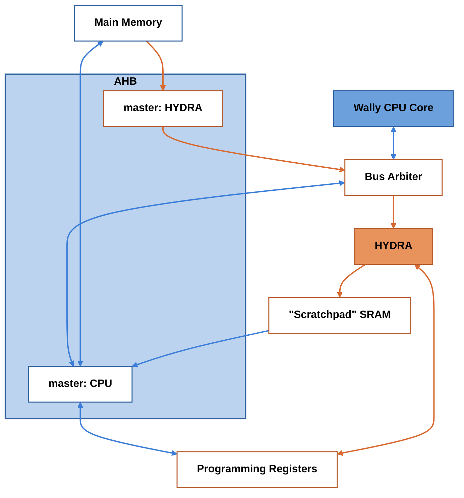

# HYDRA
**High-Yield Data Reorganization and Acceleration**

HYDRA is a smart DMA and near-memory compute engine integrated into the
[CORE-V Wally](https://github.com/openhwgroup/cvw) RISC-V SoC as a second
AHB-Lite master. It offloads data movement, reorganization, and AI/ML kernels
(gather, transpose, quantize, GEMM, pooling) from the CPU into dedicated
hardware datapaths, targeting AI/ML and DSP workloads where data movement
cost dominates compute cost.



HYDRA implements five operation modes:

- **Mode A — Scatter-gather:** collects non-contiguous vectors from main RAM
  and packs them into a contiguous scratchpad buffer.
- **Mode B — Matrix transposition:** corner-turning over BLOCK_ROWS×BLOCK_COLS
  blocks (default 8×16) of DATA_WIDTH-bit elements, written directly to
  transposed scratchpad addresses, targeting Q/K/V layout swaps in Transformer
  inference.
- **Mode C — In-flight quantization:** combinational INT32→INT8 precision
  reduction with 4:1 word packing, delivering 4× effective bandwidth on the
  write side.
- **Mode D — GEMM systolic array:** a grid of multiply-accumulate processing
  elements that reads operand matrices from memory and writes the
  product to scratchpad.
- **Mode E — Reduction/pooling:** streaming signed sum, max, min, or average
  over configurable-size windows for CNN pooling and related DSP workloads.

HYDRA sits alongside Wally's uncore as an AHB slave (MMR at `0x2000_0000`,
scratchpad at `0x2001_0000`) and an AHB master that reads from main RAM at
`0x8000_0000`. Results go to the scratchpad through a private sideband port. Completion is signaled via a PLIC interrupt (source 8) and polling through MMR's STATUS register.

This is a Rice University capstone project. The design targets functional
correctness and measured speedup (≥ 10× on matrix transposition vs.
software baseline). It is implementation-technology agnostic: it synthesizes
with standard-cell DFFs when no SRAM macro is available, and can be
retargeted to any PDK by substituting the scratchpad primitive.

---

## Repository structure

```
hydra/
├── assets/         Graphs used in README files
├── benchmark/      HYDRA's C header file and mode-based benchmark codes
├── patch/          Patches applied to Wally source files
├── pdfs/           Collection of past reports
├── scripts/
│   └── wally       Submodule management (update + save)
├── sim/
│   └── testbench   SystemVerilog self-checking testbenches
├── src/            HYDRA RTL source files
├── synth/          Synthesis scripts and reports
└── wally/          Wally cvw submodule (pinned — do not commit inside here)
```

---

## Setup

### First time (after cloning)

```bash
git clone https://github.com/Rice-MECE-Capstone-Projects/Hydra.git
cd Hydra
./scripts/wally update
```

### After pulling

```bash
git pull
./scripts/wally update
```

Always run `./scripts/wally update` after pulling. It syncs the Wally
submodule to its pinned commit and reapplies all HYDRA patches. If you skip
this step, the Wally files in your working tree will not have the HYDRA
additions and simulation/synthesis will fail.

---

## How the Wally patches work

HYDRA modifies a small number of Wally source files (config, uncore, top-level
SoC, etc.). Rather than copying or forking Wally, these modifications are stored as
`.patch` files in `patch/`. `./scripts/wally update` applies them to the Wally
submodule working tree after every sync.

Wally's git history is never touched. The submodule pointer in this repo pins
Wally to a specific commit, and patches are generated against that exact base.

### Adding or updating a patch

1. Edit the target file inside `wally/`. For example:
```bash
nano wally/config/rv32gc/config.vh
```

2. Save the patch:
```bash
./scripts/wally save
```

3. Stage and commit the updated `patch/` files.

Never stage or commit anything inside `wally/`. The submodule tracks only the
pinned commit pointer, not the working tree contents.

### Files currently patched

| Patch file | Wally file modified | Purpose |
|---|---|---|
| `adrdecs.patch` | `src/uncore/adrdecs.sv` | Address decoder entry for the HYDRA region |
| `config_rv32gc.patch` | `config/rv32gc/config.vh` | HYDRA base addresses, PLIC source ID |
| `cvw.patch` | `src/cvw.sv` | Add HYDRA fields to `cvw_t` |
| `parameter-defs.patch` | `config/shared/parameter-defs.vh` | Pass HYDRA config parameters into `cvw_t` |
| `plic_apb.patch` | `src/uncore/plic_apb.sv` | PLIC entry for HYDRA |
| `pmachecker.patch` | `src/mmu/pmachecker.sv` | Non-cacheable, non-executable PMA for the HYDRA region |
| `uncore.patch` | `src/uncore/uncore.sv` | Add `HSELHYDRA` to HRDATA/HREADY/HRESP muxes; route `HYDRAIntr` to PLIC |
| `wallypipelinedsoc.patch` | `src/wally/wallypipelinedsoc.sv` | Instantiate `hydra_top` and handle bus ownership signal from arbiter|

---

## HYDRA RTL files

| Instance | File | Description |
|---|---|---|
| `hydra_arbiter` | `src/hydra/hydra_arbiter.sv` | CPU priority, burst-boundary preemption. |
| `hydra_mmr` | `src/hydra/hydra_mmr.sv` | AHB-Lite slave MMR. Holds CTRL, SRC, DST, LEN, STATUS. Zero wait-state. |
| `hydra_scratchpad` | `src/hydra/hydra_scratchpad.sv` | Single-port 32 KB scratchpad; sideband write has priority over CPU AHB reads. |
| `hydra_top` | `src/hydra/hydra_top.sv` | Top-level wrapper with address decoding for MMR and scratchpad access. |
| `hydra_transform` | `src/hydra/hydra_transform.sv` | AHB master FSM, AGU, scatter-gather pipeline (Mode A), transposition pipeline (Mode B), quant pipeline (Mode C), GEMM systolic array (Mode D), reduction datapath (Mode E) |
| `hydra_pkg` | `src/hydra_pkg.sv` | Project's package with parameter definitions, function declarations, and corner cases |
| `sram` | `src/generic/sram.sv` | SRAM wrapper: needs to be tied to PDK used - it resolves to FFs if `SRAM_SUPPORTED` is disabled |

---

## Memory map

| Region | Base | Size | Attributes |
|---|---|---|---|
| Boot ROM | `0x0000_1000` | 4 KB | Read-only |
| CLINT | `0x0200_0000` | 64 KB | MMIO |
| PLIC | `0x0C00_0000` | 64 MB | MMIO |
| UART / GPIO | `0x1000_0000` | — | MMIO |
| HYDRA MMR | `0x2000_0000` | 4 KB | Non-cacheable |
| Scratchpad | `0x2001_0000` | 32 KB | Non-cacheable |
| Main RAM | `0x8000_0000` | 128 MB | Cached (I$/D$) |

---

## Future work

### RTL Team
- Benchmark Mode A, Mode C, and Mode D.
- All modes will chain into a single CPU-defined flow, described once through
the MMR. For example: Mode A gathers the input activations, Mode B transposes
them where the GEMM dataflow requires it, Mode C quantizes them, Mode D
multiplies them against pre-quantized weights, Mode C requantizes the
accumulators, and Mode E pools the result.

### UVM Team
Complete HYDRA's UVM verification, with priority on the newly added Modes A,
D, and E.

### FPGA Team
Extend the FPGA platform from single-mode benchmarks to end-to-end workloads:
run the chained multi-mode flow on hardware, measure performance against real
DDR latency rather than the simulation memory model, and add a Linux driver so
HYDRA can be invoked from user space.

### PD Team
Complete place-and-route in Cadence Innovus on ASAP7 and report a
comprehensive PPA comparison of Wally vs. HYDRA+Wally.

---

## License

HYDRA RTL (`src/`) — Apache-2.0 WITH SHL-2.1
Wally submodule (`wally/`) — Apache-2.0 WITH SHL-2.1 (OpenHW Group)  
Patches (`patch/`) — Apache-2.0 WITH SHL-2.1
