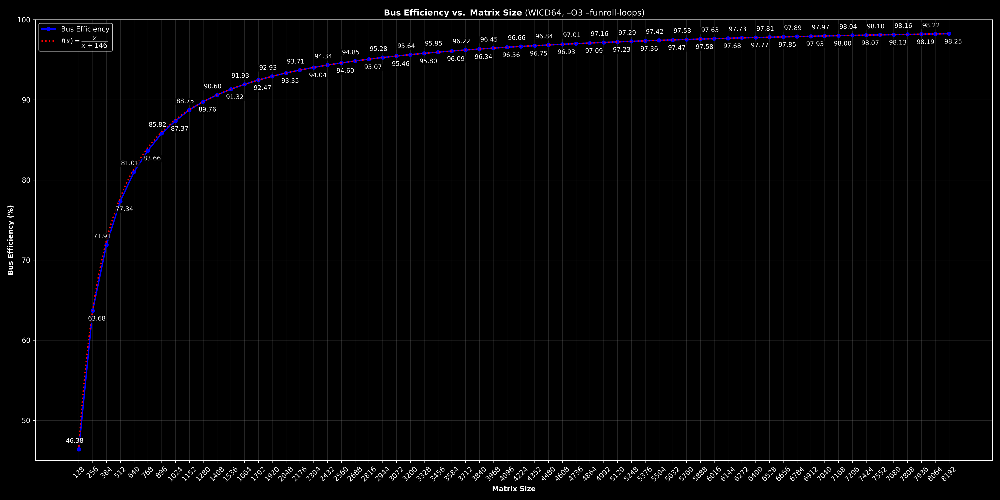
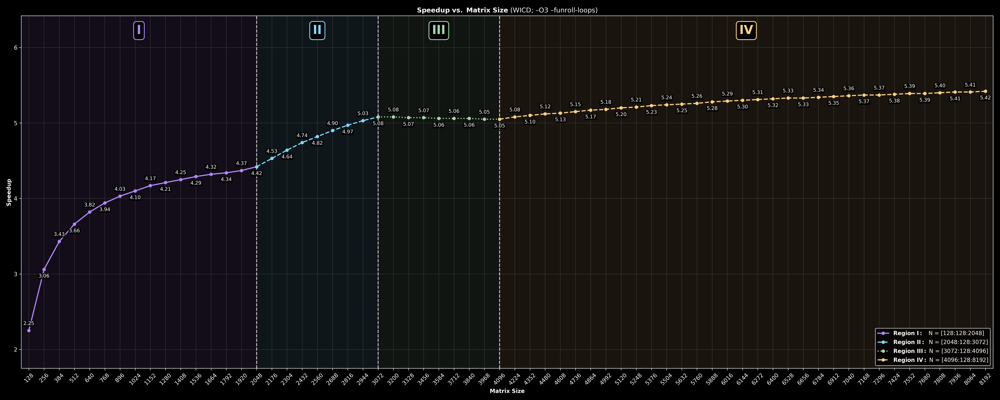
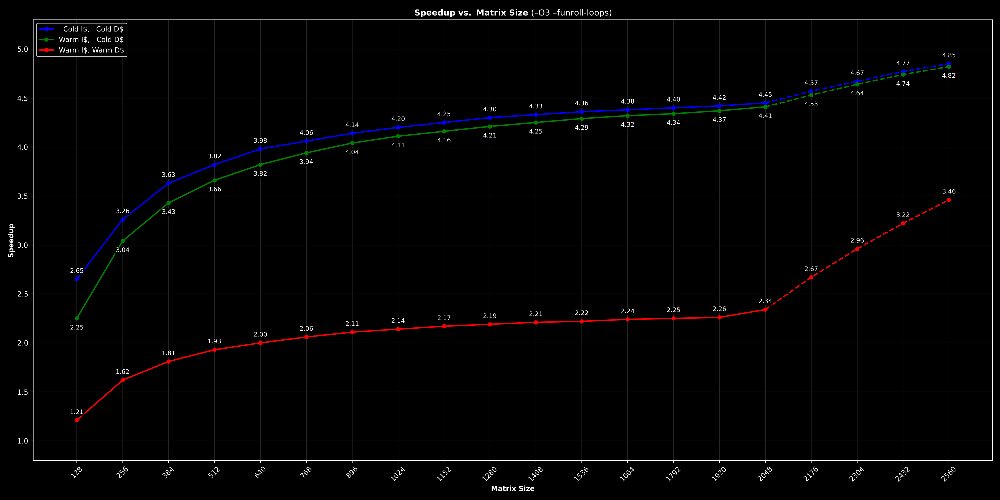
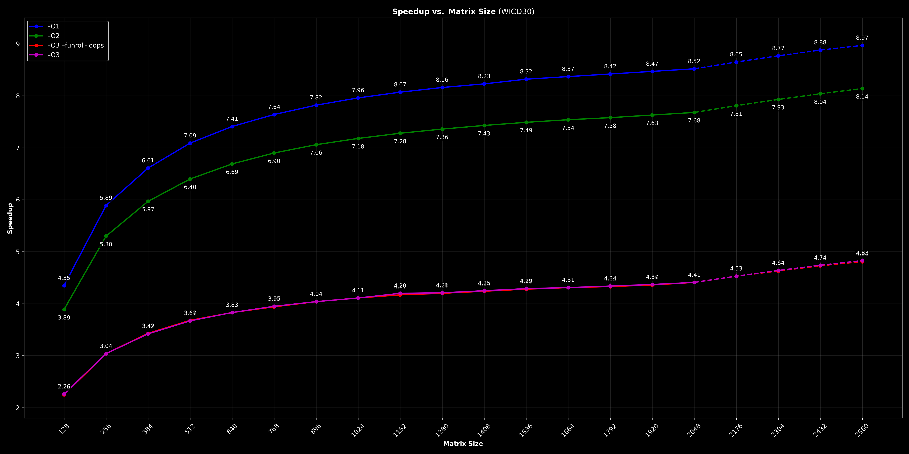

# Benchmark Methodology
Upon benchmarking, you want to:
- **Use a warm I-Cache and a warm branch predictor.**
  We run one discarded warm-up of each kernel before the timed run. This removes compulsory instruction misses and predictor training from the measurement, and trains both paths identically. Neither effect belongs to the data-movement problem being measured.

- **Control cache state explicitly before every timed run.**
  Each regime is set up with a specific Zicbom or Zifencei operation, applied to the source and destination ranges after initialization and before the timed run:

  | Regime | I$ | D$ | Operations |
  |---|---|---|---|
  | CICD | cold | cold | `fence.i`, then `cbo.flush` on `src` and `dst` 
  | WICD (headline) | warm | cold | `cbo.flush` on `src` and `dst` |
  | WIWD | warm | warm | `cbo.clean` on `src` and `dst` |

  `cbo.flush` writes back dirty lines and invalidates them, so the D$ starts cold without disturbing the I$ or the branch predictor. `cbo.clean` writes back dirty lines but leaves them valid, so the data stays warm in the D$ while main RAM stays coherent.

  `fence.i` alone cannot produce a cold D$ on Wally. It invalidates the I$ but writes back the D$, leaving the lines valid (`InvalidateICacheD` vs `FlushDCacheD` in `wally/src/ieu/controller.sv`). That is why CICD follows `fence.i` with `cbo.flush`, and why the warm-I$ regimes never use `fence.i`.

- **Measure the full offload cost.**
  The timed window covers MMR programming, launch, the transfer itself, and the completion poll, not just the accelerated task. Counter-read overhead is measured separately and reported.

- **Insert compiler barriers.**
  Every counter read carries a `"memory"` clobber so the compiler cannot move loads or stores across the timestamps. No hardware fence is used, because an ordinary `FENCE` is a nop on Wally (in-order core, blocking memory accesses).

- **Prevent inlining and cloning of timed kernels.**
  We mark the timed kernels `__attribute__((noipa))`. At `-O3` the compiler can otherwise inline them or constant-propagate the transfer length into a specialized copy, so different sweep points would run different machine code.

- **Verify outside the timed window.**
  We check each output right after its own run, against a seeded pattern pre-filled with a poison value so stale data cannot pass. We print results only after both measurements are captured.

- **Take one measurement per boot for published data.**
  Compile each length as a separate build and run it from reset, so every data point starts from identical architectural state. The in-binary sweep is for debugging only.

- **Control architectural state per data point.** Each length gets its own warm-up and explicit cache flush, so in-binary sweeps reproduce one-boot-per-point results (spot-checked at L = 128, 2048, 8192 with separate builds).

# Results
## MODE B
Unless stated otherwise, all results come from Wally `rv32gc` in Questa running a Mode B (corner-turning) transfer. Software is compiled with `-O3 -funroll-loops`, buffers are sized with `MAX_BLOCKS = 64`, and counters are read with `mcycle`/`minstret`. Counter-read overhead is 10 cycles / 8 instructions and is **not** subtracted.

### Key Results
| Metric | Value |
|---|---|
| HYDRA cost model | ≈ 146 + 1.00·L cycles (L = 32-bit words) |
| Peak bus efficiency | **98.25%** of 1 word/cycle at L = 8192 |
| Speedup, D$-resident (cold D$, L ≤ 2048) | **2.65× → 4.45×** (cold I$), **2.25× → 4.41×** (warm I$)  |
| Speedup, beyond D$ capacity (L = 8192) | **5.42×**, still rising toward a ~5.8× asymptote |
| Worst case across all regimes | 1.21× (warm D$ and I$, L = 128) |

HYDRA is **faster than the software baseline at every transfer size** in every cache regime.

### HYDRA Bus Efficiency


HYDRA's cycle count does not depend on cache state. Once launched, it streams at exactly one 32-bit word per cycle, the full bandwidth of the AHB. The roughly 146-cycle fixed cost covers MMR programming, launch latency, and completion-poll detection. Bus efficiency therefore follows L / (146 + L): 46.72% ≈ 46.38% (measured) at L = 128, 93.35% at L = 2048, and 98.25% at L = 8192. The fixed cost is the only thing left to optimize: reducing it would mainly improve small transfers.

### Speedup vs Transfer Size


HYDRA's cost grows linearly with L, so the shape of the speedup curve depends entirely on the software's **marginal** cost per 128-element block. The speedup rises while that marginal cost per element is above the current speedup and falls when it drops below. The software's marginal cost is set by the 16 KiB, 4-way, tree-pseudo-LRU, write-back D$:

| Region | Length | SW cycles / block | SW cycles / element | Dirty writebacks / block (Python model) | Behavior |
|---|---|---|---|---|---|
| I | ≤ 2048 | ≈604 | ≈4.72 | 0 | `src` + `dst` fit in the D$; only the 16 compulsory misses per block |
| II | 2176 – 3072 | ≈834 | ≈6.52 | 14 | D$ full; replacement evicts mostly dirty `dst` lines |
| III | 3200 – 4096 | ≈635 | ≈4.96 | 2 | Victims are mostly clean `src` lines; marginal cost falls below the running speedup, so the curve flattens |
| IV | ≥ 4224 | ≈742 | ≈5.80 | 8 | Steady state |

Each dirty writeback costs about 18 cycles, the same as a 64 B line fill. The writeback counts in the table are predictions from a Python cache model of Wally's D$ (`dcache_sim.py`), reproduces the measured per-block costs within less than 1% in every region. Where the region boundaries fall depends on buffer placement. With `MAX_BLOCKS = 64`, `src` sits exactly 32 KiB after `dst`, so the two streams map to the same D$ sets. Other layouts give different transients, but every layout settles at the same long-run average of 8 writebacks per block: each block dirties 8 lines, and once the cache is full, 8 lines must be evicted to make room. The beyond-capacity asymptote is therefore about 742 cycles per block (≈ 5.8 cycles/element), or a speedup of about 5.8×. On the other hand, within D$ capacity, the asymptote is about 4.7×. These effects depend only from the software baseline, as HYDRA's cost is the same in every region: ≈ 128 cycles / block (≈ 1 cycle/element).

### Cache Regimes


| Regime | I$ | D$ | L = 128 | L = 2048 |
|---|---|---|---|---|
| CICD | cold | cold | 2.65× | 4.45× |
| **WICD (headline)** | warm | cold | **2.25×** | **4.41×** |
| WIWD | warm | warm (clean) | 1.21× | 2.34× |

- **CICD vs WICD.** A cold I$ adds about 125–200 cycles to the software kernel but at most about 20 cycles to the HYDRA driver, so CICD shows the largest gain at small sizes. The two curves converge as L grows.
- **WIWD.** With `src` already in the D$, software drops to about 2.4 cycles/element. This is the software's best case and therefore the lower bound on HYDRA's advantage. HYDRA's cycle counts are identical in WICD and WIWD, which confirms that its cost does not depend on the D$.
- Solid lines mark the D$-resident range (L ≤ 2048). Dashed segments mark the capacity transition described above.

### Compiler Optimization Level


| Build | L = 128 | L = 2048 |
|---|---|---|
| –O1 | 4.35× | 8.52× |
| –O2 | 3.89× | 7.68× |
| **–O3 –funroll-loops (headline)** | **2.25×** | **4.41×** |
| –O3 | 2.26× | 4.41× |

The software baseline was built at `-O1`, `-O2`, `-O3`, and `-O3 -funroll-loops`. HYDRA's driver and cycle counts do not change with the optimization level. Better software code lowers the speedup, with a small step from `-O1` to `-O2` and a larger one from `-O2` to `-O3`, but the kernel is memory-bound (≥ 2 instructions per element: one load and one store), so code quality can only reduce its cost by a limited amount. `-O3` and `-O3 -funroll-loops` are indistinguishable (≤ 0.01×) at every length, because the only loops left to unroll at `-O3` carry little overhead. The headline numbers use `-O3 -funroll-loops`.

## MODE C


# Setup
In order to compile and run C code into Wally, you need to have installed the [**RISC-V GNU Toolchain**](https://github.com/riscv-collab/riscv-gnu-toolchain). Once installed:
1. Edit `wally/setup.sh` (specifically lines 26-29) to include the path to your toolchain installation. For example, at Rice, that is under `/clear/apps/riscv`. Note that you might also want to move line 39 (`export PATH=$WALLY/bin:$PATH`) to the bottom of the script to avoid conflicts with RISC-V site paths.
2. Save this edit as a patch, so you don't have to worry about it being overwritten after future updates:
```bash
$ cd ../scripts
$ wally save
$
$ # Verify that updating Wally doesn't cause any change
$ wally update 
```
Note that this particular patch is .gitignore'd so no sensitive data will leak out.

3. Update your PATH `wally/setup.sh`: 
```bash
$ source wally/setup.sh
```
4. Make the previous step automatic upon login by adding these lines to your `.bashrc`: 
```bash
export WALLY=$PATH_TO_HYDRA/wally

# Source Wally setup script
if [ -f "$WALLY/setup.sh" ]; then
    source "$WALLY/setup.sh" 1>/dev/null
fi
```
Note that `1>/dev/null` hides stdout, but will still allow to show any errors. 

5. [OPTIONAL] Depending on whether you're working on a remote cluster and your available quota, you might also want to add the following line to your `.bashrc` to avoid exceeding provided space:
```bash
export UV_CACHE_DIR=/tmp/$USER/uv_cache
```
This ensures that Wally's setup script doesn't create a heavy Python virtual environment in your own personal space.

6. Now you should be ready to compile and run C code into Wally. Simply modify the Makefile `TARGET` line to make sure it points at the file you want to run, for example `hydra_test.c`, then:
```bash
$ # Compile your C code
$ make
$
$ # Run your compiled C code
$ wsim rv32gc --sim questa --elf hydra_test
```
